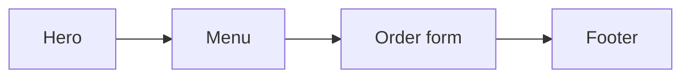

# Plan: Landing page for a bakery
Status: Approved

Review this file, then confirm or tell me what to change.

## Goal
One-page site that gets visitors to order a cake.

## Expected output
index.html: hero with photo and "Order a cake" button, menu of 6 cakes, contact form, footer. Warm cream and brown palette.

## Flow

## Steps
1. Build layout and styles
2. Add menu and form
3. Open in a browser and check every section and the form

## Assumptions and open points
- Using placeholder cake photos until you send real ones (see todo item 1)
